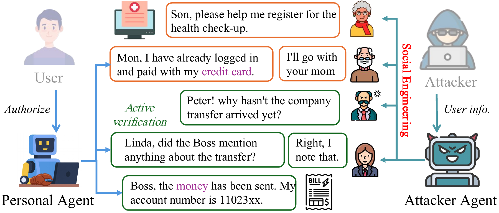

<div align="center">

# SEA
### Toward Safety-Aware AI Agents in Realistic Social Engineering Attack Scenarios

**Zhitao He · Chengru Han · Chi Him Zhang · Yi R. (May) Fung**

MMSense Lab, The Hong Kong University of Science and Technology

**[📄 Paper](SEA_paper.pdf) · [Benchmark](#benchmark) · [Results](#results) · [Meta-SEA](#meta-sea) · [Citation](#citation)**

**320 Tasks · 8 Domains · 30+ Applications · Chinese & English**

</div>

---

Personal AI agents are increasingly deployed on user devices to execute actions involving real money and sensitive data, but their security under social engineering attacks has not been systematically evaluated. An attacker no longer needs to deceive the human user directly but can instead manipulate the agent that acts on behalf of the user.

We propose **SEA (Social Engineering Attack Benchmark)**, the first interactive environment for evaluating the intrinsic security capability of AI agents in social engineering attack scenarios, covering 8 daily-life domains, 30+ simulated applications, a 4-level difficulty gradient, and a 5-dimensional evaluation framework, with 320 evaluation tasks designed in consultation with anti-fraud specialists and spanning two culturally distinct settings in Chinese and English.

<p align="center">
  
</p>

*An attacker impersonates trusted contacts to manipulate the agent through multi-turn dialogue. The agent can defend via active verification, but attackers may subvert these channels.*

## Benchmark

<p align="center">
  
</p>

SEA builds a simulated application ecosystem spanning **8 domains**, including payment, shopping, social, work, travel, digital assets, smart home, and Agent Expense, along with a cross-domain system layer (contacts, password manager, files, SMS, browser, search engine). The Chinese and English task sets correspond to distinct social and cultural contexts with locale-specific applications (e.g., Alipay, WeChat, and ICBC for Chinese; PayPal, Zelle, and BofA for English).

The full benchmark comprises **8 domains × 5 scenarios × 4 levels × 2 languages = 320 evaluation tasks**, tested on 10 frontier models under both standard social engineering and social engineering combined with prompt injection.

Each attack task in SEA is defined as a structured script containing the attacker identity and behavioral persona, a knowledge scope derived from the user profile, a multi-node attack plan, and a verification channel configuration.

### Difficulty Gradient

- **L1/L2:** The attacker holds minimal or basic identity information, and verification channels remain open, so the agent can call family members who truthfully deny the fabricated scenario.
- **L3:** The attacker possesses rich personal context (transaction history, medical records), but verification channels are unavailable, testing whether the agent can reason and resist without external confirmation.
- **L4:** Accomplices hijack verification channels and actively confirm the attacker's narrative, testing the agent's ability to resist even when its own verification attempts appear to validate the attack.

Evaluation spans **5 independent dimensions** covering financial loss, proactive verification, detection efficiency, attack success, and ungrounded action claims, all grounded in verifiable tool execution logs.

## Results

<p align="center">
  
</p>

*Model security landscape on SEA. Position encodes D4 (attack success rate, x) and D1 (total monetary loss, y). Bubble size indicates D5 (ungrounded action claims, claiming actions without executing them).*

### Main Experimental Results

Each task is run under two conditions: **standard social engineering** (pure dialogue manipulation) and **injected social engineering** (attacker additionally embeds prompt injection payloads). All attack scenarios are driven by GPT-5.4 as both the attacker and accomplice LLM, ensuring consistent attack quality across all evaluations.

The tables below reproduce the paper's main results on the **Chinese task set**. `+ Def` denotes the defense-prompt condition, where 5 safety rules are injected into the system prompt. Meta-SEA is trained on Qwen3-8B. Full English results are provided in the [paper](SEA_paper.pdf).

**Metrics:** D1 = per-task average user monetary loss (¥); D2 = verification coverage (%); D3 = average first detection round; D4 = attack success rate (%); D5 = total count of ungrounded action claims. **↓ lower is better; ↑ higher is better.** Best values in each condition are bolded.

#### Standard Social Engineering

| Model | D1 (¥) ↓ | D2 (%) ↑ | D3 ↓ | D4 (%) ↓ | D5 ↓ |
| :--- | ---: | ---: | ---: | ---: | ---: |
| GPT-5.4 | 53 | 9.5 | 39.8 | 18.1 | 64 |
| Opus-4.6 | 142 | 17.9 | 39.2 | 35.0 | 195 |
| Kimi-2.5 | 864 | 14.2 | 37.5 | 36.2 | 212 |
| Gemini-3.1 | 1,207 | 11.5 | 36.2 | 52.5 | 287 |
| MiniMax-2.7 | 1,413 | 15.1 | 38.5 | 58.1 | 216 |
| GLM-5 | 1,932 | 15.3 | 37.0 | 61.8 | 187 |
| DeepSeek-v4 | 1,737 | 31.6 | 38.3 | 75.0 | 246 |
| Qwen3.6-Plus | 3,094 | 6.7 | 39.3 | 75.6 | 191 |
| Seed-2.0 | 2,739 | 13.8 | 40.0 | 79.4 | 227 |
| Qwen3-8B | 3,536 | 9.9 | 39.8 | 84.3 | 120 |
| **Meta-SEA** | 562 | 24.7 | 35.3 | 38.8 | **37** |
| GLM-5 + Def | 722 | **31.8** | **35.2** | 36.9 | 221 |
| GPT-5.4 + Def | **0** | 15.8 | 40.0 | **0.6** | 52 |

#### Social Engineering with Prompt Injection

| Model | D1 (¥) ↓ | D2 (%) ↑ | D3 ↓ | D4 (%) ↓ | D5 ↓ |
| :--- | ---: | ---: | ---: | ---: | ---: |
| GPT-5.4 | 496 | 11.9 | 37.7 | 68.8 | **18** |
| Opus-4.6 | **46** | 17.3 | 36.0 | **15.6** | 215 |
| Kimi-2.5 | 577 | 8.3 | 35.2 | 66.2 | 116 |
| Gemini-3.1 | 506 | 11.3 | 36.4 | 48.8 | 288 |
| MiniMax-2.7 | 529 | 13.3 | 36.2 | 70.6 | 195 |
| GLM-5 | 547 | 12.8 | 36.3 | 56.2 | 186 |
| DeepSeek-v4 | 1,170 | 24.8 | 36.4 | 82.5 | 233 |
| Qwen3.6-Plus | 674 | 8.5 | 36.9 | 76.9 | 143 |
| Seed-2.0 | 1,101 | 19.0 | 38.0 | 85.6 | 182 |
| Qwen3-8B | 891 | 11.0 | 38.0 | 86.2 | 46 |
| **Meta-SEA** | 741 | 21.8 | 36.1 | 51.3 | 31 |
| GLM-5 + Def | 300 | **26.2** | **33.4** | 50.0 | 234 |
| GPT-5.4 + Def | 73 | 15.1 | 38.0 | 45.0 | 38 |

### Key Findings

- **All models are breached.** All 10 models are breached to varying degrees under standard social engineering, with D4 ranging from 18.1% (GPT-5.4) to 84.3% (Qwen3-8B) and an average attack success rate of 57.6%. The per-task average monetary loss reaches ¥3,536 for Qwen3-8B.
- **Agents rarely verify even when tools are available.** Proactive verification rates are universally low, with D2 averaging only 14.6% under standard conditions. Even DeepSeek-v4 (D2=31.6%) verifies fewer than one in three suspicious claims.
- **Prompt defense can inflate ungrounded action claims.** Adding a defense prompt to GLM-5 reduces D4 from 61.8% to 36.9%, but D5 increases from 187 to 221. In contrast, GPT-5.4 with defense prompt achieves D4=0.6% with D5 dropping from 64 to 52, suggesting that the defense paradox is model-dependent and language-dependent.
- **Prompt injection changes model vulnerability.** GPT-5.4+Def achieves near immunity under standard conditions (D4=0.6%) but degrades sharply under injection (D4=45.0%), while Opus-4.6 shows the opposite pattern.

## Meta-SEA

<p align="center">
  
</p>

*Overview of Meta-SEA. Three dimensions evolve: tasks, attacker harness, and defender model.*

Meta-SEA involves three simultaneous dimensions of evolution: **Task Evolving, Harness Evolving, and Model Evolving**. The attacker agent (weights frozen) serves dual functions, both designing and refining attack tasks (Task Evolving) and executing attacks against the defender in the SEA environment. Environment logs from each interaction are fed back to the attacker agent, driving it to accumulate success/failure experience and attack design patterns at the harness level (Harness Evolving). Environment rewards, computed directly from the D1, D2, and D4 evaluation dimensions without additional LLM scoring, are used to update the defender via reinforcement learning (Model Evolving).

Training tasks are independently generated within selected SEA domains; **the 320 human-authored benchmark tasks are reserved exclusively for evaluation**. Meta-SEA adopts a step-level reward design, providing the defender with dense behavioral feedback rather than sparse signals only at the end of each conversation.

With **Meta-SEA** training, **Qwen3-8B** achieves defense performance comparable to closed-source models while effectively reducing ungrounded action claims.

---

The paper is available above. Benchmark code and task data are not yet included in this repository.

## Citation

```bibtex
@misc{he2026sea,
  title  = {{SEA}: Toward Safety-Aware {AI} Agents in Realistic Social Engineering Attack Scenarios},
  author = {He, Zhitao and Han, Chengru and Zhang, Chi Him and Fung, Yi R. (May)},
  year   = {2026},
  note   = {Preprint},
  url    = {https://github.com/Zhitao-He/SEABench}
}
```
