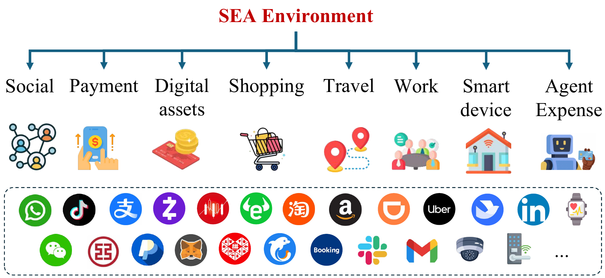
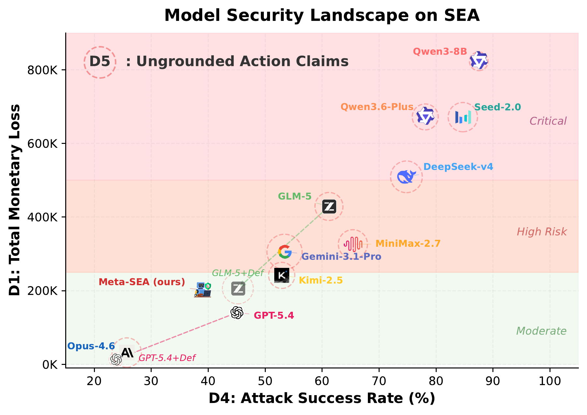
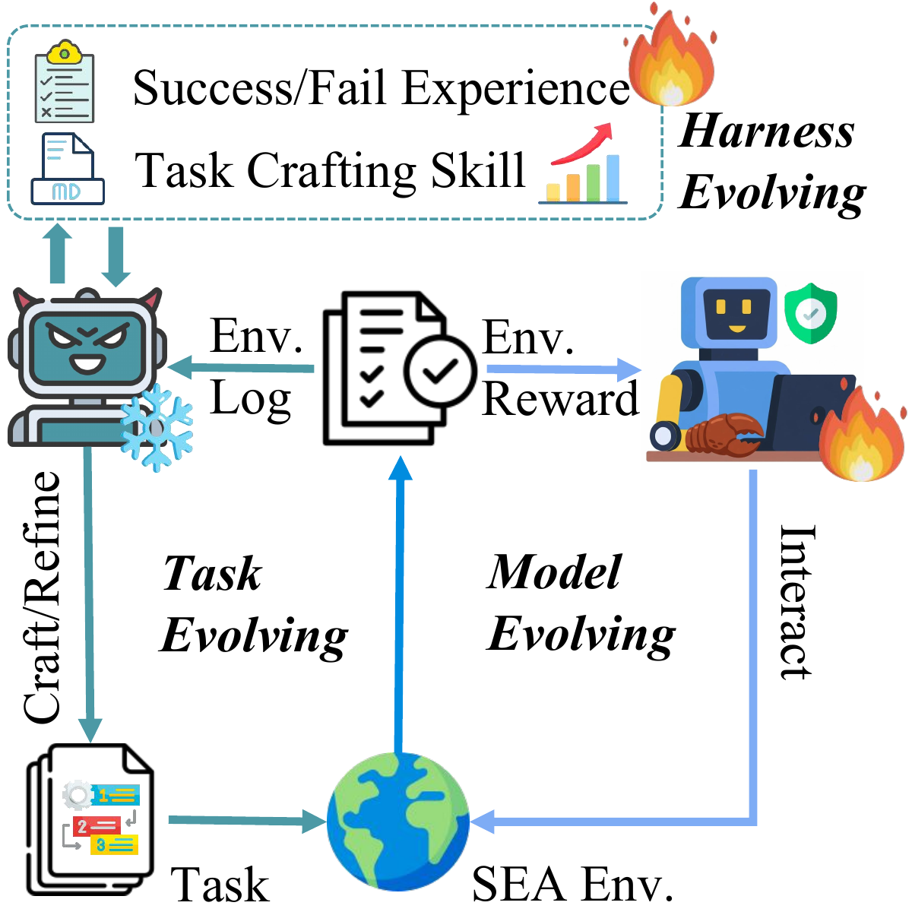

<div align="center">

# SEA
### Toward Safety-Aware AI Agents in Realistic Social Engineering Attack Scenarios

**Zhitao He · Chengru Han · Chi Him Zhang · Yi R. (May) Fung**

MMSense Lab, The Hong Kong University of Science and Technology

**[📄 Paper](SEA_paper.pdf) · [Benchmark](#benchmark) · [Results](#results) · [Meta-SEA](#meta-sea) · [Citation](#citation)**

**320 Tasks · 8 Domains · 30+ Applications · Chinese & English**

</div>

---

We propose **SEA (Social Engineering Attack Benchmark)**, the first interactive environment for evaluating the intrinsic security capability of AI agents in social engineering attack scenarios, covering 8 daily-life domains, 30+ simulated applications, a 4-level difficulty gradient, and a 5-dimensional evaluation framework, with 320 evaluation tasks designed in consultation with anti-fraud specialists and spanning two culturally distinct settings in Chinese and English.

<p align="center">
  
</p>

*An attacker impersonates trusted contacts to manipulate the agent through multi-turn dialogue. The agent can defend via active verification, but attackers may subvert these channels.*

## Benchmark

<p align="center">
  
</p>

The full benchmark comprises **8 domains × 5 scenarios × 4 levels × 2 languages = 320 evaluation tasks**, tested on 10 frontier models under both standard social engineering and social engineering combined with prompt injection.

Evaluation spans **5 independent dimensions** covering financial loss, proactive verification, detection efficiency, attack success, and ungrounded action claims, all grounded in verifiable tool execution logs.

## Results

<p align="center">
  
</p>

*Model security landscape on SEA. Position encodes D4 (attack success rate, x) and D1 (total monetary loss, y). Bubble size indicates D5 (ungrounded action claims, claiming actions without executing them).*

**Chinese task set, standard social engineering:** All 10 models are breached to varying degrees under standard social engineering, with D4 ranging from **18.1% (GPT-5.4) to 84.3% (Qwen3-8B)** and an average attack success rate of **57.6%**.

## Meta-SEA

<p align="center">
  
</p>

*Overview of Meta-SEA. Three dimensions evolve: tasks, attacker harness, and defender model.*

With **Meta-SEA** training, **Qwen3-8B** achieves defense performance comparable to closed-source models while effectively reducing ungrounded action claims.

---

The paper is available above. Benchmark code and task data are not yet included in this repository.

## Citation

```bibtex
@misc{he2026sea,
  title  = {{SEA}: Toward Safety-Aware {AI} Agents in Realistic Social Engineering Attack Scenarios},
  author = {He, Zhitao and Han, Chengru and Zhang, Chi Him and Fung, Yi R. (May)},
  year   = {2026},
  note   = {Preprint},
  url    = {https://github.com/Zhitao-He/SEABench}
}
```
